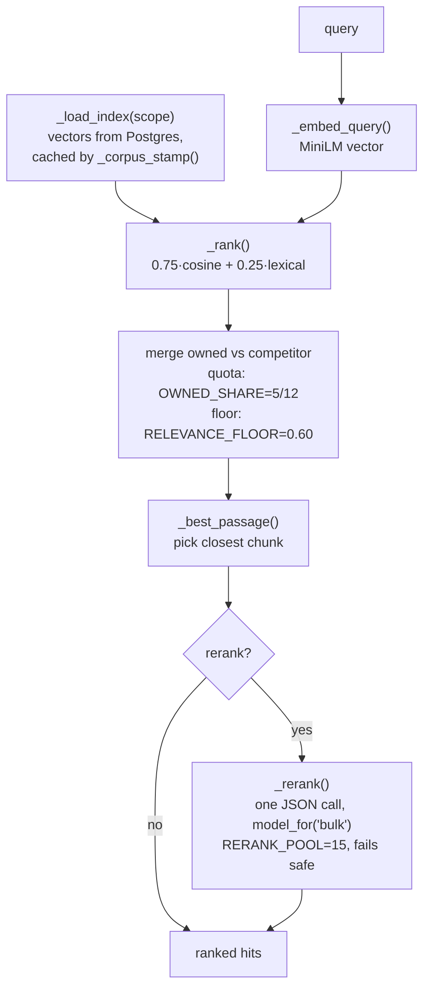

# Low-level: LLM, speech-to-text, embeddings, and RAG

Which models the platform uses, how it picks them, and how search actually ranks results.

## The model the platform runs on

The code is **vendor-neutral on purpose**. Nothing in the source names an LLM vendor. Code
asks for a *tier* and the concrete model id comes from config (`BEC/config/settings/base.py`,
overridable in `BEC/.env`). Swapping providers is an env change, not a code change.

**Since 2026-11-15 the chain has two links and nothing else: Groq, then the local model.**
Anthropic (the paid key, rejected with 401 since early October), the `aiapiflow` reseller
(balance exhausted, and it resold Claude access) and HuggingFace (dormant) are gone from the
code, the settings, `.env.example` and `requirements.txt` (`anthropic` and its Batch API stage
with them). The decision is Giuseppe's: «o Groq o chiamate al modello locale, punto».

### `model_for(task)` — the three tiers

Defined in `BEC/llm/client.py`. Callers ask for a task, not a model:

| Tier call | Used for |
|---|---|
| `model_for("analysis")` | the *strongest* model: reading transcripts, extracting claims/themes, naming clusters |
| `model_for("reasoning")` | strategy briefs, blog drafts, editorial plan |
| `model_for("bulk")` | high-volume mechanical extraction, the **search reranker** (Groq only), blog URL-pattern classification |

It returns the tier's model **on the first live provider**. Callers pass that string back as
`chat(model=...)`; `chat()` re-resolves it per provider via `_task_of()` as it walks the chain,
so a caller never needs to know who will answer — and provider #2 is never asked for provider
#1's model name, which it would 404 on.

### The provider chain (ordered, one entry per provider)

`LLM_PROVIDER_ORDER` (default `fast,ollama`) picks the *kinds* of provider; `LLM_ENDPOINTS`
lists the remote ones **in priority order**, each with its own url, key and models:

```
LLM_ENDPOINTS=groq
LLM_GROQ_BASE_URL / _API_KEY / _MODEL_ANALYSIS / _MODEL_REASONING / _MODEL_BULK
LLM_GROQ_MODEL_CHAIN     (same-provider fallbacks for daily caps)
```

A `.env` written before the chain existed still works: with `LLM_ENDPOINTS` unset, one endpoint
is built from the old `LLM_*` / `FAST_LLM_*` names.

**One dialect.** Every remote provider speaks OpenAI's shape (`POST /chat/completions`,
`Authorization: Bearer`) and goes through `_fast_chat`. There is no `dialect` field any more: it
existed only for Anthropic's own API (`/v1/messages`, `x-api-key`), which is gone.

- **fast** — every entry of `FAST_ENDPOINTS`, in order (Groq).
- **ollama** — local, the last resort. Serialized by a file lock (`_ollama_slot`) because the
  CPU fits one ~7B generation at a time; an interactive caller can claim `priority`.
  The number of threads is `OLLAMA_NUM_THREAD` (default 6, sent as `options.num_thread` by
  `_ollama_chat`; `0` = do not send it). Ollama's own default is all 18 cores, and on this VDS
  (EPYC Zen 1, KVM) the ceiling is memory, not cores. Measured with qwen2.5 7b Q4_K_M:
  18 threads 0.2-0.8 tok/s, 12 threads 1.4-1.9, **6 threads 3.8-4.0**, 4 threads 2.9-3.2.

Errors, and what each one does to the chain:

| Response | Exception | Effect |
|---|---|---|
| 429 | `LLMRateLimit` | waits `retry-after` (≤60s); if the cap is *daily*, walks that provider's own `_MODEL_CHAIN` — free tiers cap tokens per model per day, so a sibling model still has budget |
| 401 / 402 / 403 | `LLMCreditError` | **that endpoint only** is skipped for the rest of the process; the next one answers |
| 404 | `LLMModelMissing` | the provider is fine, the model name is not on it: move to the next endpoint **without** disabling this one |
| anything else | logged at WARNING, retried, then next endpoint | a misconfigured provider must never fail silently |

> **Why per-endpoint and not global.** Until 2026-09-13 one flag disabled the whole remote
> layer, so a single dead gateway dropped everything to the local 3B model — silently. Measured
> damage: of 1066 enrichments, 947 were done by `claude-opus-5` and **61 by `ollama:qwen2.5:3b`**
> after the gateway's balance ran out, with 164 more left `failed`. `Enrichment.llm_model` records
> the model that *actually* served (`last_model_used()`), which is the only way that was visible.

### Deployed configuration (2026-11-15)

| Priority | Provider | Analysis / Reasoning | Bulk | Notes |
|---|---|---|---|---|
| 1 | **Groq** (`api.groq.com/openai/v1`) | `openai/gpt-oss-120b` | `openai/gpt-oss-20b` | free, no card; **caps tokens per minute (public: 8,000 for the 120b) and per day (200,000)**; ~0.4s per call |
| 2 | **Ollama** (local) | `qwen2.5:7b-instruct-q4_K_M` | same | backstop. Apache 2.0, 4.7 GB. The old 3b is **not** usable for a client: its licence is "Qwen Research", non-commercial |

Known limits, measured rather than assumed:

- **Local Ollama is slow by hardware.** The machine tops out at ~5.6-7 tok/s in total for the 7b,
  even with answers in parallel; reading the prompt runs at 9-13 tok/s. Bigger memory pages and
  passive waiting were tried and gave nothing. The 3b model has not been re-measured at 6 threads.

- Groq retired `llama-3.3-70b-versatile` and `llama-3.1-8b-instant`; both 404 on this account.
  Live catalogue: `openai/gpt-oss-120b`, `openai/gpt-oss-20b`, `qwen/qwen3.8-27b`,
  `qwen/qwen3.6-27b`, `groq/compound`, `groq/compound-mini`, `whisper-large-v3`.
- **gpt-oss models emit reasoning tokens before the answer**, billed against `max_tokens`. One
  enrichment prompt: 406 completion tokens at default effort, 263 at `reasoning_effort: low`,
  identical JSON quality. At `max_tokens=20` the answer came back **empty** with
  `finish_reason: "stop"` — a silent failure. `_fast_chat` sets `reasoning_effort: low` on any
  `gpt-oss` model.
- Groq's free tier caps requests per day per model (order of 250-1,000; read the live figure in
  console.groq.com → Settings → Limits). That is what `_MODEL_CHAIN` is for.
- **Every call is now recorded** (since 2026-11-13) in `llm_calls` — see
  [«What is recorded for each call»](#what-is-recorded-for-each-call). Money is still read on
  the provider's own dashboard; what the table gives is calls, tokens and **seconds per process**.

### What is recorded for each call

`llm/usage.py`, hooked in `chat()` (`llm/client.py`) — the one place all 16 callers pass
through, so none of them changed. Numbers and short labels only: **no prompt, no answer**.

- **Local model (Ollama).** The row is born `waiting` **before** the lock, goes `running` as
  the lock is taken (`wait_seconds`), counts tokens live (one stream chunk per token, written at
  most every 2 s), and closes with Ollama's own last line: `prompt_eval_count`, `eval_count`,
  `load/prompt_eval/eval_duration` (nanoseconds). `done_reason == "length"` or a timeout that
  returns partial text (`_ollama_chat` returns what it has, without an error) → `truncated`.
  "No free slot after 900 s" → `failed`.
- **Remote models** (`_fast_chat`): a row at the start and one
  update at the end, with the token counts the provider reports (`usage`; if absent the tokens
  stay empty and the row is still written). No live tokens: they answer all at once.
- **Whisper** (`transcriber_agent._transcribe`) is not a `chat()` call, but takes the same
  machine: `usage.stt()` records it (`kind='stt'`) so its hours enter the daily totals.
- **Who asked**: `usage.scope(process, stage, job_id, run_id)` — set by `DAG.run`
  (`pipeline:<stage>`), `run_job` (`job:<kind>`) and the reranker (`mcp:cerca`, only when
  nothing else labels it). Rows older than 2026-11-15 may carry `web:chat`; the page labels
  them «Chat sui contenuti (funzione tolta)». Without a scope: `cmd:<command>` or
  `altro`. The label lives in a contextvar **and** a process-wide fallback set from the main
  thread, because a contextvar does not cross into a `ThreadPoolExecutor` (`enrich` uses 5
  threads); the fallback is not set from web request threads (it would leak between requests).
- **Recording never breaks a call.** Every write is in a savepoint and wrapped: on any error a
  warning is logged and the call goes on; a database error also trips a 30 s breaker so a dead
  database does not add a connection timeout to every model call.
- Machine hours = seconds the local model held the lock + local transcription; **not**
  multiplied by the 18 cores (one generation uses the whole machine; measured 2026-11-13, see
  the decision log in `.claude/tasks/2026-11-13-processi-locali.md`).

Measured on this VDS before the thread fix (kept because the page's first job is to show it):
qwen2.5 7b Q4_K_M at 18 threads 0.2-0.8 tok/s, at 6 threads 3.8-4.0 tok/s; the memory bus, not
the cores, is the ceiling. Ollama loads the model with a 4096-token window (`/api/ps`,
`client.py` does not set `num_ctx`): a longer prompt is cut silently. Not changed here.

### Token ceilings (and the Batch API, removed)

The nightly analysis used to go through Anthropic's Batch API (half price, answers within 24h,
stage `batch`, table `batch_runs`, `manage.py sonnet_batch`). **Removed 2026-11-15**: the stage had
delivered nothing since 2026-10-03 (key rejected), zero rows were left in `batched`, and the
client wants no Anthropic call at all. The 26 receipts are exported to a file at release, before the
migration (`0027`) drops the table (the command is in the task file, «da fare in produzione»); which model analysed what is already in
`enrichments.llm_model` (947 Opus 5, 406 Sonnet 5, 138 gpt-oss-120b at the time).

**Token ceilings are a correctness issue, not a cost knob.** A truncated answer is unparseable
JSON — a *lost* analysis, not a shorter one. Measured on the 2026-09-13 backlog run (Sonnet 5):
at `max_tokens=700`, 6 of ~150 enrichment answers truncated; at 1200, 2 more still did; claim
extraction at 600 lost **74 of 139**. Current values: `ENRICH_MAX_TOKENS = 2000`, claim
extraction 1200.

The model also occasionally wraps the object in an array (`[{...}]`) — 10 of ~150 answers.
`write_enrichment` unwraps a single-element list rather than throwing away an answer.

**Re-embed after a re-analysis.** A document's vector is built from its title, summary and
topics as well as its body, so rewriting an analysis leaves the old vector in place and the
document keeps being found by the wrong questions. `embed_status` says `done`, so nothing
revisits it on its own — set it back to `pending` for the rows you re-analysed. This bit the 323
articles recovered on 2026-09-13: their summaries had been empty when they were first embedded.

## Speech-to-text

- **Remote (preferred when `USE_REMOTE_STT`):** `whisper-large-v3` via `transcribe_audio()`,
  configured with `STT_BASE_URL` / `STT_API_KEY`. Deliberately a **separate endpoint** from the
  text LLM so the two can scale and fail independently.
- **Local fallback:** faster-whisper (`WHISPER_MODEL=small`, int8) on CPU.

## Embeddings

- **Model:** `EMBEDDINGS_MODEL = sentence-transformers/paraphrase-multilingual-MiniLM-L12-v2`
  (a local multilingual MiniLM). Loaded lazily in `core/knowledge.py` (`_get_embedder`) and in
  `cluster_agent._get_embedder`.
- Vectors are **normalized**, so cosine similarity = a dot product.
- **Storage:** JSON columns in Postgres — no pgvector (see
  [01-data-model.md](01-data-model.md#why-embeddings-are-json-not-pgvector)).
- **What text gets embedded for a reel:** `enrichment.summary_it` + `topics` +
  `transcript[:4000]` (`_EMBED_TEXT_CHARS`). The 4000-char cap matters: an earlier version
  read only `transcript[:600]`, which made anything past ~40 seconds invisible to ranking.

## Retrieval / RAG — `core/knowledge.py`

This module powers the MCP `cerca` tools and `GET knowledge/search/`. (It used to power the
in-app chat too, removed 2026-11-15.)



### `semantic_search(query, top_k, scope, rerank)`

1. **Load index** — `_load_index(scope)` reads all vectors from Postgres and caches them in
   `_INDEX_CACHE`, keyed on a cheap `_corpus_stamp()` fingerprint (uses `Max(updated_at)` so
   in-place re-embeds invalidate the cache). Only `is_active=True, is_on_topic=True` documents
   and `enrich_status=DONE` reels with non-empty text are indexed.
   - **`kind` filter (optional).** `kind="reel"` / `"blog"` narrows the index to one content type
     right here, exactly as `only_inspiration` narrows it to reference material. This is what the
     typed MCP tools (`cerca_reel` / `cerca_articoli`) pass. It matters for **latency**: filtering
     the type up front means the pool the rerank pays for is all the right type and of size
     `want=max(top_k, RERANK_POOL)`, instead of over-fetching a mixed pool of `top_k*3=24` and
     discarding most after the LLM ran. Measured, that cut a typed search from 11–14s into the
     `cerca_tutto` regime (~2.6s), and killed the starvation where a minority type post-filtered
     to fewer than `top_k` results. Callers that want both types leave `kind=None`.
2. **Embed the query** — `_embed_query()`.
3. **Hybrid rank** — `_rank()` blends dense and lexical: `0.75 * cosine + 0.25 * lexical_score`.
   The lexical term (`_lexical_score`) is what catches exact drug/brand names like "Bijuva"
   that a fuzzy vector might miss.
4. **Keep the two sides fair** — under `scope="all"`, owned and competitor are ranked
   *separately* then merged with a quota: `OWNED_SHARE = 5/12` and a relevance floor
   `RELEVANCE_FLOOR = 0.60`. This stops the bigger corpus from crowding out Medyca's smaller
   one. Queries that mention "blog"/"articol…" reserve half the slots for articles.
5. **Pick the passage** — `_best_passage()` selects the chunk (from cached `chunk_vectors`)
   closest to the query, so a hit shows the *relevant* passage, not the article's first lines.
6. **Optional rerank** — `_rerank(query, out)` makes **one** structured LLM call
   (`model_for("bulk")`, `max_tokens=2000`, `retries=0`) over a `RERANK_POOL=15` candidate
   pool, asking for a JSON `{"ordine": [...]}` ordering, then returns the top `top_k`. On *any*
   failure it falls back to the blend order — it never errors out. MCP `cerca` calls it with
   `rerank=True`; it is **Groq only** (see below).
   - **Known limit / why `retries=0`:** with a full pool of long snippets Sonnet 5 sometimes
     prefaces the JSON with a line of reasoning and tips over the ceiling (`stop_reason=max_tokens`).
     At the old `max_tokens=1000` this surfaced as an intermittent **~30–40s hang** on MCP search —
     the client saw "search not working" — because a truncation is deterministic yet the default
     `retries=2` retried it 3× with backoff before the fallback ran (2026-09-15). `2000` gives
     headroom (the same real pool reranks in ~2–3s) and `retries=0` makes the rare truncation fall
     back to the blend order in one shot instead of multiplying the latency.

### The chat is gone

`answer()` / `_prepare()` (the grounded RAG chat reply, its prompt, the pasted-page references
read through `core/external_ref.fetch_reference`) and `knowledge/ask/` were **removed
2026-11-15**: the client uses the MCP connector, and with a local fallback a chat answer would
have taken minutes. Nothing was stored by the chat, so no migration. `core/knowledge.py` now has
one job: `semantic_search`.

Next: [the MCP connector](04-mcp-connector.md).
